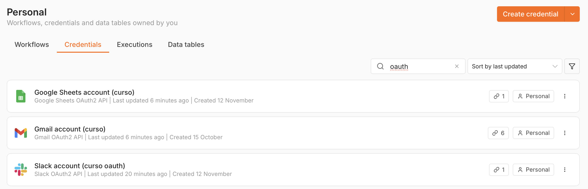

# Checkpoint 4 · Integraciones del sistema de cobranza

**Natalia Lusso** · AI Automation Avanzado (Coderhouse)
Proyecto integrador: sistema de cobranza para una promotora inmobiliaria (empresa y datos ficticios).

Archivo del workflow: [`checkpoint4_natalia_lusso.json`](checkpoint4_natalia_lusso.json). Se importa en n8n desde *Workflows → Import from File*. Al importarlo, cambia `cobros@promotorademo.example` en el filtro del Gmail Trigger por la dirección real del buzón de cobros.

## Qué se suma al Módulo 3

El workflow conserva todo lo anterior: el chat interno con el Manager, los Workers y la memoria en Airtable. Además incorpora un **segundo canal de entrada, el buzón de cobros**. Cuando un cliente escribe para enviar un justificante, consultar su saldo o pedir un plazo, el sistema:

1. lo identifica en el CRM;
2. registra el contacto;
3. deja preparada una respuesta en **Borradores**;
4. avisa al equipo en Slack.

Nada se envía sin revisión humana.

```
[Gmail Trigger · buzón de cobros]
        │
① [IF ¿Respuesta automática?] ── Sí ─▶ Ignorar (corta el bucle)
        │ No
④ [Set Limpiar email] → [Filtro ¿Email válido?]        (evita el 400)
        │
② [Buscar cliente en CRM]  (look up por email)
        │
   [Agente de correo]  (Tools Agent · GPT-4o-mini · lee Contratos)
        │
   [Datos para el CRM] → [IF ¿Existe en el CRM?]
                    Sí ─▶ [Actualizar cliente]   No ─▶ [Crear cliente]   (evita el 409)
        │
③ [Gmail · Crear borrador de respuesta]  (human-in-the-loop)
        │
④ [Set Aviso mínimo para Slack] → [Slack · Aprobar envío]  (botones Enviar / No enviar, máx. 48 h)
        │ Enviar                          │ No enviar
   [Gmail API · enviar el borrador]       [Slack · registrar no enviado]
        │
   [Slack · confirmar envío]
```

## Los 4 controles de la rúbrica

| # | Nodo | Qué evita |
|---|---|---|
| ① | **¿Respuesta automática?** (IF justo después del trigger) | El bucle infinito. Ignora el correo si el asunto contiene *auto-reply, automatic reply, respuesta automática, out of office, fuera de la oficina, undeliverable* o *delivery status notification*. También si el remitente es *no-reply / noreply / mailer-daemon* o el correo trae la cabecera `Auto-Submitted`. Además, el trigger excluye los correos propios (`-from:me`). |
| ② | **Buscar cliente en CRM** antes de crear | Duplicados (409). Busca el email: si existe, lo **actualiza**; si no, lo **crea**. |
| ③ | **Crear borrador de respuesta** (Gmail · Draft · Create) + **Aprobar envío en Slack** | Envíos sin aprobación. La respuesta del agente queda en Borradores, en el mismo hilo. El responsable la lee en Slack y pulsa *Enviar respuesta* o *No enviar*. Solo con su aprobación se envía **ese mismo borrador** (Gmail API `drafts.send`), incluidas las correcciones que haya hecho en Gmail. Sin respuesta en 48 h, no se envía nada. |
| ④ | **Limpiar email** + **¿Email válido?**, y **Aviso mínimo para Slack** | Payloads pesados y mal formados (400). Solo pasan email, nombre, asunto, texto (máx. 2.000 caracteres) e hilo; se descartan HTML y adjuntos, y se valida el email. A Slack llegan un aviso de 3 líneas y la respuesta propuesta, nunca el correo original ni sus adjuntos. |

## Credenciales (OAuth2) y mínimo privilegio



| Rol | Herramienta | Credencial n8n | Lectura (pasado) | Escritura (futuro) | Permisos |
|---|---|---|---|---|---|
| CRM | Google Sheets, pestaña **Clientes** | Google Sheets OAuth2 API | Busca el contacto por email | Crea o actualiza el contacto | `spreadsheets`, `drive.file` |
| Casilla de correo | Gmail (buzón de cobros) | Gmail OAuth2 API | Lee los correos no leídos dirigidos al buzón de cobros | Crea borradores; envía un borrador **solo tras la aprobación en Slack** | Los scopes que fija n8n para Gmail; el workflow solo lee, crea y envía borradores |
| Canal del equipo | Slack, #cobranza-revision | Slack OAuth2 API | Recibe la decisión (Enviar / No enviar) | Publica el aviso y la confirmación | Scopes personalizados: `chat:write`, `channels:read` |

La memoria del Módulo 3 (Airtable) usa un token personal limitado a una sola base y a leer y escribir registros. No es una de las tres integraciones de este módulo. Los nodos de Slack heredados del Manager (escalado y log) también usan la credencial Slack OAuth2.

### Por qué el CRM es Google Sheets

En esta promotora, los datos del cliente ya viven en la hoja de cobranza (Contratos, Cuotas, Movimientos). Por eso la pestaña **Clientes** cumple el rol de CRM: es la fuente única de verdad del contacto. Guarda email, nombre, cliente, contrato, origen, estado, primer y último contacto, última intención, último asunto, resumen e interacciones.

Se descartó HubSpot porque, desde junio de 2026, HubSpot ya no permite crear desde su web las *legacy public apps* que necesita la credencial OAuth2 de n8n ([changelog de HubSpot](https://developers.hubspot.com/changelog/legacy-public-app-creation-sunset)). La lógica es la misma con cualquier CRM: *look up* → *update* o *create*. Para cambiar a HubSpot o Pipedrive basta con sustituir los tres nodos del CRM.

## Prueba de regresión

Cada nodo se probó con *Execute step* y el flujo completo con *Execute workflow*:

- **Correo con asunto "Respuesta automática: fuera de la oficina":** sale por la rama *true* del IF y no llega al agente.
- **Correo de un remitente nuevo:** el contacto se crea en Clientes, se genera el borrador en el hilo y llega a Slack el aviso con los botones. Al pulsar *Enviar respuesta*, el correo sale en el mismo hilo.
- **Segundo correo del mismo remitente:** el contacto se actualiza (interacciones +1) y no se crea un duplicado.
